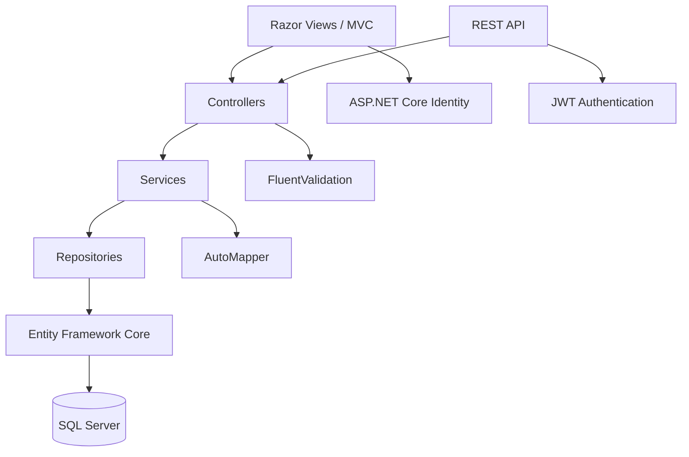

# Arquitetura do BarberFlow

## Objetivo

O BarberFlow usa uma arquitetura em camadas pragmática dentro de uma única aplicação .NET 8. A decisão reduz a complexidade operacional do projeto de portfólio sem misturar responsabilidades.

## Responsabilidades

- **Controllers:** recebem requisições, validam autorização e coordenam o caso de uso.
- **Services:** concentram regras de negócio, disponibilidade e indicadores.
- **Repositories / EF Core:** persistência e consultas.
- **DTOs / ViewModels:** evitam expor entidades diretamente e modelam contratos/telas.
- **Validators:** regras de entrada com FluentValidation.
- **Middleware:** tratamento centralizado de exceções e respostas adequadas para MVC/API.
- **Identity/JWT:** autenticação conforme o canal de acesso.

## Decisões importantes

1. MVC e API compartilham regras de negócio para evitar duplicação.
2. Entidades não são usadas como contrato público da API.
3. Reservas passam por nova validação de disponibilidade antes da persistência.
4. Dados de demonstração são idempotentes e destinados apenas ao ambiente de portfólio.
5. O pipeline de CI valida build, testes e Docker a cada alteração relevante.
