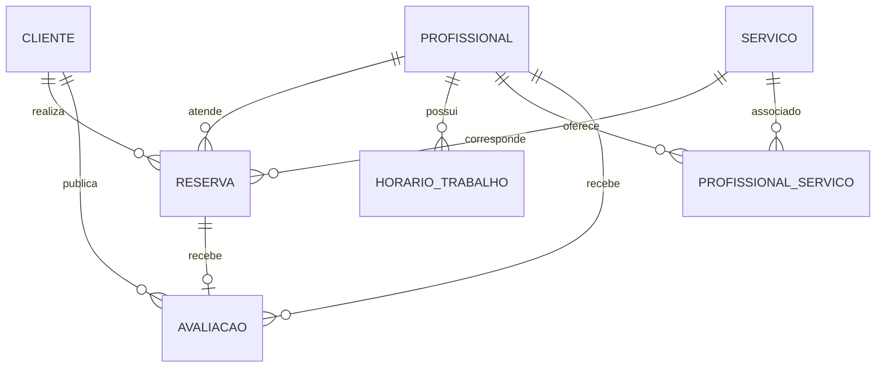

# Modelo de dados

## Relacionamentos principais

## Entidades

- **Cliente:** dados do cliente vinculados ao fluxo de reservas.
- **Profissional:** perfil público, vínculo de usuário, especialidade e situação ativa.
- **Servico:** nome, descrição, duração, preço e situação ativa.
- **HorarioTrabalho:** períodos de trabalho por profissional e dia da semana.
- **Reserva:** cliente, profissional, serviço, início, fim e status.
- **Avaliacao:** nota/comentário associado a um atendimento concluído.
- **ProfissionalServico:** relacionamento muitos-para-muitos entre profissional e serviço.

As migrations do Entity Framework Core versionam as mudanças estruturais do banco.
